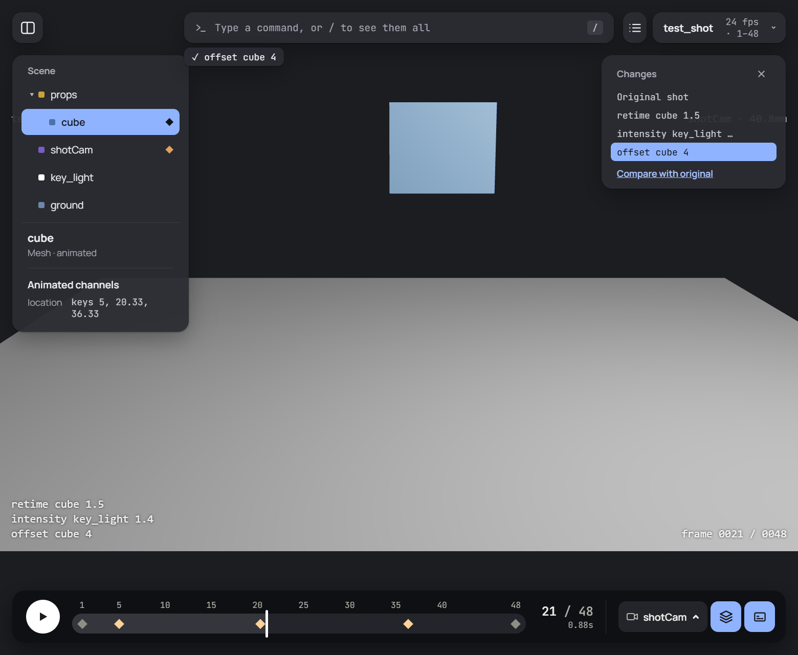

<p align="center">
  <picture>
    <source media="(prefers-color-scheme: dark)" srcset="resources/RapidVis-logo/svg/rapidvis-lockup-on-dark.svg" />
    
  </picture>
</p>

<p align="center">
  <strong>Fast pre-vis review: open a shot, change it with typed commands, send the changes back to Blender.</strong>
</p>

<p align="center">
  
  
  
</p>

---

RapidVis is a review tool for VFX and pre-vis shots. You export a shot from Blender, and it opens in a fast 3D viewer with its cameras, lights and animation. You make changes by typing commands such as `retime cube 1.5` or `focal shotCam 50`. You can export a review movie with a burn-in. The changes save as a small command log, and the Blender add-on replays that log on the real scene as a single undo step.



## Contents

- [Features](#features)
- [How it works](#how-it-works)
- [Requirements](#requirements)
- [Installation](#installation)
- [Using RapidVis](#using-rapidvis)
- [Commands](#commands)
- [Keyboard shortcuts](#keyboard-shortcuts)
- [File formats](#file-formats)
- [Development](#development)
- [Project layout](#project-layout)
- [Licence](#licence)

## Features

- **Round trip with Blender.** One click exports a shot and opens it in RapidVis. The edits come back with *File › Import › RapidVis edits*.
- **Typed commands.** You can retime, offset, trim, move, rotate and scale (the whole animation or a single key), hide or show objects, and change a light's intensity and colour or a camera's lens. The command bar autocompletes, and `/` lists every command.
- **Non-destructive history.** Every change is a row in the Changes panel. You can undo, redo, jump to any point, mute a single change, or press `C` to compare against the original shot.
- **Scene outliner and properties.** The outliner shows the hierarchy and which objects are animated. The properties card lists each object's animated channels and has controls for lights and lenses. Those controls run commands too, so they appear in the history.
- **Look through any shot camera.** The view is letterboxed to the camera's sensor and focal length, as in Blender.
- **Movie export.** MP4 in H.264 or AV1, at 720p, 1080p or 2160p, through any camera, with an optional burn-in (shot, camera, lens, frame and the list of edits).
- **Desktop app.** Native open and save dialogs, Open Recent, opening a shot from the command line (`RapidVis.exe shot.glb`), and a light and a dark theme.

## How it works

```
 Blender                       RapidVis                           Blender
┌──────────────┐  .glb +     ┌─────────────────────────────┐ .rvedits.json ┌──────────────────┐
│ Export to    │  manifest   │ view · scrub · type commands │──────────────▶│ Import RapidVis  │
│ RapidVis     │────────────▶│ compare · export a movie     │               │ edits (one undo) │
└──────────────┘             └─────────────────────────────┘               └──────────────────┘
```

1. The **Blender add-on** writes the shot as a `.glb` (glTF binary) next to a `.manifest.json`. The manifest holds the frame rate, frame range, camera sensors, lens and light animation, and the original object names.
2. The **viewer** (TypeScript and three.js, packaged with Electron) plays the shot. Each command is checked before it goes into the log. The edited shot is then rebuilt from the untouched original plus the log, which is why undo and mute are always exact.
3. **Save changes** writes the log as `<shot>.rvedits.json`. The add-on turns each command into the same change on the real Blender scene.

## Requirements

| For | You need |
| --- | --- |
| Running the viewer from source | [Node.js](https://nodejs.org/) 24 or newer (npm comes with it) |
| Exporting and applying edits | [Blender](https://www.blender.org/) 5.1 or newer |
| Movie export | A browser engine with WebCodecs (the desktop app has one built in) |

The desktop build is set up for Windows. The app also runs on macOS from source (`npm run app`), but there's no packaged Mac build yet.

## Installation

### 1. The RapidVis app

```bash
git clone https://github.com/KieranKnight/RapidVis.git
cd RapidVis/viewer
npm install
```

Then pick how to run it:

| Command | What you get |
| --- | --- |
| `npm run dev` | The viewer in your browser at <http://localhost:5173>, reloading as you edit the code |
| `npm run app` | The desktop app, built and started |
| `npm run package` | A standalone Windows app in `viewer/release/win-unpacked/RapidVis.exe` |

### 2. The Blender add-on

The add-on is a Blender extension. Build it into a `.zip` with Blender's own tool:

```bash
blender --command extension build --source-dir blender/rapidvis_addon --output-dir .
```

Then, in Blender:

1. Open **Edit › Preferences › Get Extensions**, and in the **⌄** menu at the top right choose **Install from Disk…**. Pick the `rapidvis-0.1.0.zip` you just built.
2. In **Edit › Preferences › Add-ons › RapidVis**, set **RapidVis app** to your `RapidVis.exe` (or `RapidVis.app` on a Mac). This is what lets *Export to RapidVis* open the shot for you.

## Using RapidVis

1. **Export the shot from Blender.** Use **File › Export › RapidVis (.glb + manifest)**, or the **RapidVis** tab in the 3D view's sidebar (`N`). Leave *Open in RapidVis* ticked and the app opens with the shot.
2. **Or open a shot in the app.** Use **Ctrl O**, the shot menu at the top right, or drop a shot folder (or a `.glb` with its manifest) anywhere on the window.
3. **Review and change.** Scrub the timeline, look through the shot camera, and type commands. Click an object in the view or the Scene panel to see its details.
4. **Save changes** with **Ctrl S**. This writes `<shot>.rvedits.json` next to the shot. *Load changes…* in the shot menu brings a saved file back in.
5. **Export a movie** with **Ctrl E**. Choose the camera, size, codec and burn-in.
6. **Apply the changes in Blender** with **File › Import › RapidVis edits (.rvedits.json)**. They all land as one undo step, and anything that can't be applied is listed as a warning.

## Commands

Type these in the command bar at the top. Object names autocomplete. `help` or `help <command>` explains one, and `/` lists them all.

| Command | What it does |
| --- | --- |
| `retime <object> <factor>` | Plays its animation faster or slower (2 = twice as fast, 1 = as exported) |
| `offset <object> <frames>` | Slides its animation later (or earlier, with a minus) by some frames |
| `trim <start> <end>` | Sets the first and last frame of the shot |
| `move-all <object> <x> <y> <z>` | Moves it on every frame, in Blender axes and metres |
| `rotate-all <object> <x°> <y°> <z°>` | Rotates it on every frame, in degrees |
| `scale-all <object> <x> <y> <z>` | Scales it on every frame (1 1 1 = as exported) |
| `move-key <object> <x> <y> <z> [at <frame>]` | Moves one key: on this frame, or the one after `at` |
| `rotate-key <object> <x°> <y°> <z°> [at <frame>]` | Rotates one key |
| `scale-key <object> <x> <y> <z> [at <frame>]` | Scales one key |
| `hide <object>` / `show <object>` | Hides it (and everything parented to it), or shows it again |
| `intensity <light> <factor>` | Makes a light brighter or dimmer (2 = twice as bright, 0 = off) |
| `color <light> <#rrggbb>` | Sets a light's colour |
| `focal <camera> <mm>` | Sets a camera's lens, in millimetres |

Every command sets an absolute value. Typing `retime cube 2` and then `retime cube 1.5` leaves the cube at 1.5×, not 3×.

## Keyboard shortcuts

| Key | Action |
| --- | --- |
| `Space` | Play / pause |
| `←` `→` | Previous / next frame |
| `↑` `↓` | Next / previous key (the selected object's, or every key) |
| `/` | Type a command |
| `Esc` | Deselect (or leave the command bar) |
| `Tab` | Show / hide the side panels |
| `H` | Show / hide the Changes panel |
| `T` | Hide every card for a clean look at the shot |
| `O` | Overlays (grid, camera and light gizmos) on / off |
| `B` | Burn-in on / off |
| `C` | Compare with the original shot |
| `Ctrl Z` / `Ctrl Y` (or `Ctrl Shift Z`) | Undo / redo |
| `Ctrl O` · `Ctrl S` · `Ctrl E` | Open shot · save changes · export movie |

On a Mac, use `Cmd` instead of `Ctrl`.

## File formats

| File | What it is |
| --- | --- |
| `<shot>.glb` | The scene, its cameras and lights, and the object animation (glTF 2.0 binary, Y-up) |
| `<shot>.manifest.json` | What glTF can't carry: fps, frame range, camera sensors, lens and light curves, Blender names |
| `<shot>.rvedits.json` | The saved changes: a versioned list of commands. See [docs/rvedits-format.md](docs/rvedits-format.md) |

A test shot is in [`fixtures/`](fixtures): `test_shot.blend`, its export, and a set of edits.

## Development

```bash
# Viewer: unit tests (Vitest), type-check, formatting
cd viewer
npm test
npx tsc --noEmit
npm run format

# Blender add-on: the parts that don't need Blender (Pytest)
cd blender
python -m pytest
```

The add-on's Blender-free logic (the manifest, the translation from commands to Blender operations, and launching the app) is plain Python, so it's tested with Pytest. The Blender-dependent parts can be run headless against the fixture:

```bash
blender -b --factory-startup fixtures/test_shot.blend --python blender/scripts/export_headless.py -- out/test_shot.glb
blender -b --factory-startup fixtures/test_shot.blend --python blender/scripts/apply_headless.py -- fixtures/test_shot.rvedits.json out/edited.glb
```

## Project layout

```
RapidVis/
├── viewer/                    The app (TypeScript, three.js, Vite, Electron)
│   ├── src/
│   │   ├── main.ts            Creates each part and wires them together
│   │   ├── shotPlayer.ts      The open shot: original, edits, and the animation mixer
│   │   ├── shortcuts.ts       Which key does what
│   │   ├── commands/          Parsing, applying and saving commands (pure, unit-tested)
│   │   ├── export/            Movie recording
│   │   └── ui/                The panels, menus, timeline and dialogs
│   ├── electron/              The desktop app's main process and preload
│   └── public/, build/        Icons and logos for the page and the packaged app
├── blender/
│   ├── rapidvis_addon/        The Blender extension: export, apply edits, preferences
│   ├── scripts/               Headless export / apply, and the test-shot generator
│   └── tests/                 Pytest
├── docs/                      File format notes
├── fixtures/                  A test shot
└── resources/RapidVis-logo/   The logo pack (SVG, PNG, ICO)
```

## Licence

The repository doesn't have a licence file yet. The Blender add-on declares **GPL-3.0-or-later** in its manifest, as Blender requires for extensions.

The logo uses JetBrains Mono SemiBold (SIL Open Font License), outlined in the SVGs.
